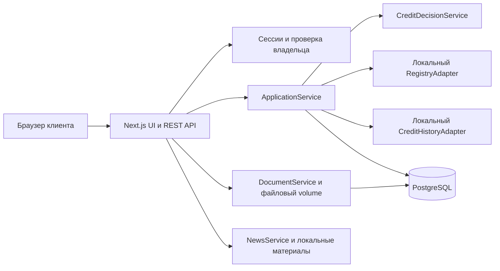
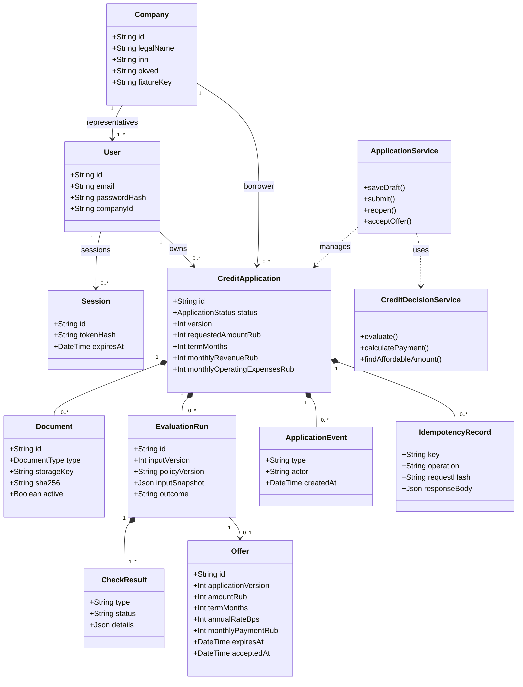
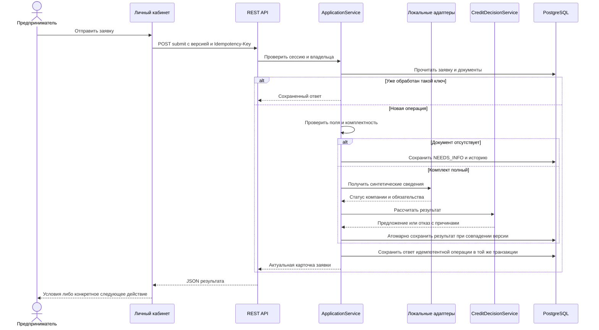
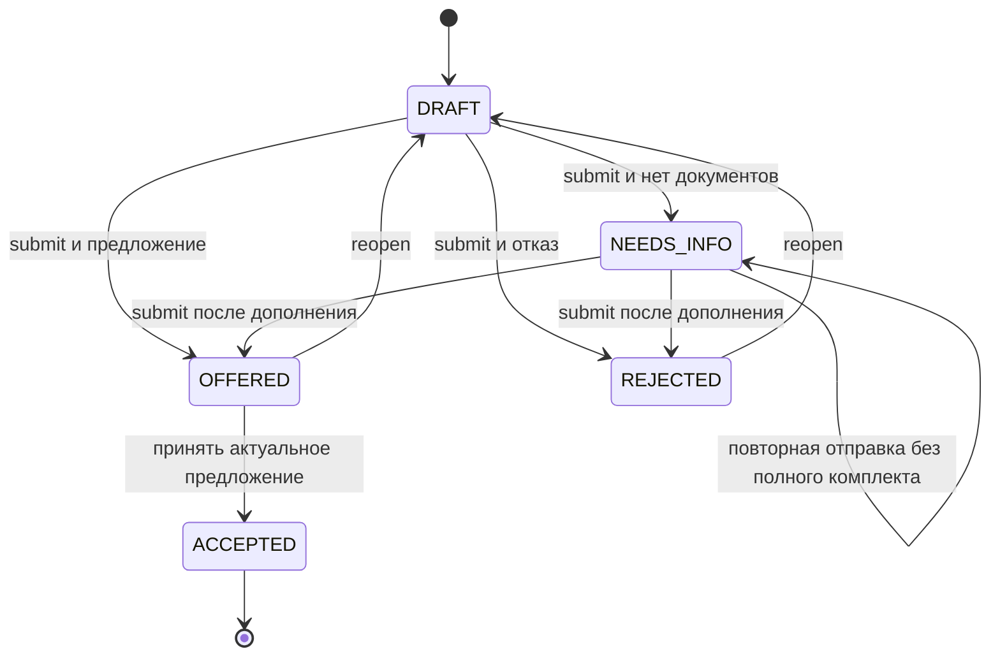

# Умный кредитный кабинет предпринимателя

## Проектная документация

Версия спецификации: 1.0. Дата: 24 октября 2026 года. Горизонт реализации: двухдневный хакатон.

**Статус документа:** проектное описание целевого MVP. Документ не утверждает, что код уже реализован, тесты пройдены или приложение развернуто. Фактические результаты проверки должны быть добавлены в README при сдаче.

Связанные материалы:

- [Техническая спецификация для реализации](02_TECHNICAL_SPECIFICATION.md).

## 1 Назначение решения

Веб-приложение помогает предпринимателю оформить заявку на финансирование, подготовить сведения и документы, получить результат автоматической обработки и понять дальнейшие действия. Все пользовательские действия происходят внутри личного кабинета клиента.

Банковская часть процесса реализуется серверными сервисами: проверками полноты, локальными симуляторами внешних источников, расчетом платежа и формализованными правилами принятия решения. Пользовательского интерфейса сотрудника банка, административного кабинета и ручного рассмотрения в MVP нет.

Решение ориентировано на микро- и малые торговые компании России. Этот фокус выбран как продуктовая гипотеза для демонстрации понятного оборотного цикла. Он не означает, что потребность конкретного сегмента уже подтверждена интервью или что прототип воспроизводит кредитную политику Альфа-Банка.

## 2 Продуктовая граница

В MVP представлен один кредитный продукт `WORKING_CAPITAL`: пополнение оборотных средств. Предприниматель выбирает этот продукт, указывает конкретную цель и параметры. Несколько целей внутри продукта не изображаются как разные банковские продукты.

| Параметр демонстрационного продукта | Значение |
|---|---|
| Валюта | RUB |
| Запрашиваемая сумма | От 500 000 до 5 000 000 рублей |
| Срок | Любое целое число месяцев от 6 до 24 |
| Ставка | Фиксированные 20,00% годовых |
| Платеж | Аннуитетный, округление вверх до целого рубля |
| Документы | Выписка по счету и финансовый отчет в PDF |
| Результаты | Запрос документов, предложение полной суммы, предложение меньшей суммы, отказ |
| Срок действия предложения | 24 часа от формирования |
| Завершение сценария | Принятие актуального предложения клиентом |

Все указанные лимиты, ставка и правила — настройки синтетического продукта. Они не являются актуальными предложениями реального банка, нормативными порогами или индивидуальной финансовой рекомендацией.

В состав MVP входят вход по демонстрационным аккаунтам, просмотр профиля компании, черновики заявок, загрузка документов, автоматическая обработка, объяснение результата, исправление заявки, принятие предложения, история событий и персонализированная информационная лента.

За границами MVP находятся регистрация реального бизнеса, электронная подпись, перечисление денег, реальные подключения к ФНС и БКИ, OCR, обучение ML-модели, LLM, SMS, почта, платежные сервисы, микросервисы и автоматическое развертывание в облаке.

## 3 Пользовательский путь

1. Клиент входит в заранее подготовленный аккаунт и видит синтетическую компанию.
2. На главной странице выбирает оборотное финансирование.
3. Создает черновик, заполняет цель, сумму, срок и финансовые показатели.
4. Сохраняет черновик и при необходимости возвращается к нему после обновления страницы.
5. Загружает два документа либо отправляет заявку с отсутствующим документом, чтобы получить конкретное уточнение.
6. Система проверяет комплектность, сведения компании, кредитные обязательства и доступность платежа.
7. Клиент получает запрос документов, предложение условий либо отказ с объяснением.
8. При запросе документов дополняет заявку и повторяет отправку.
9. При получении предложения принимает его либо возвращает заявку в редактирование для изменения параметров.
10. История показывает действия клиента и системы; данные сохраняются после перезапуска приложения.

### 3 1 Экраны

| Страница | Назначение |
|---|---|
| `/login` | Вход, объяснение демонстрационного режима, учетные данные для проверки |
| `/dashboard` | Компания, заявки, доступные действия, информационная лента |
| `/applications/new` | Создание заявки с заранее заполненными данными компании |
| `/applications/[id]/edit` | Пошаговое редактирование и документы |
| `/applications/[id]` | Результат, условия, недостающие документы, история и дальнейшее действие |

Компания привязана к аккаунту на сервере. Подменять компанию параметром запроса или переключателем «одобрить/отказать» в интерфейсе нельзя.

### 3 2 Персонализированная лента

В приложении хранится небольшой набор редакционных демонстрационных материалов. Подбор учитывает отрасль компании и состояние последней заявки. Статьи объясняют оборотное финансирование, подготовку документов, доступность платежа и принятие предложения.

Каждый материал содержит заголовок, краткий текст, полный текст и объяснение релевантности. Материалы маркируются как справочные демонстрационные публикации; они не имитируют свежие новости или объявления банка. После изменения состояния заявки состав ленты пересчитывается.

## 4 Функциональные требования

| ID | Требование | Приемочный признак |
|---|---|---|
| FR-01 | Вход и выход через серверную сессию | После выхода защищенный API возвращает 401 |
| FR-02 | Изоляция клиентов | Чужая заявка и ее документы недоступны |
| FR-03 | Сохранение черновика | Поля восстанавливаются после обновления страницы |
| FR-04 | Серверный расчет платежа | Сумма, срок и расчет согласованы между формой и предложением |
| FR-05 | Загрузка PDF | Файл хранится вне публичного каталога и доступен владельцу |
| FR-06 | Проверка комплектности | Отсутствующий документ указан явно |
| FR-07 | Локальные проверки компании и обязательств | Ответы детерминированы по синтетической компании |
| FR-08 | Объяснимое решение | Результат содержит причины, а не только цветовой индикатор |
| FR-09 | Альтернативная сумма | Уменьшение суммы соответствует расчетной доступности |
| FR-10 | Повторная отправка | Используются новые данные, старое предложение утрачивает актуальность |
| FR-11 | Принятие предложения | Допускается только для актуального и неистекшего предложения |
| FR-12 | История событий | Видны дата, действие и инициатор CLIENT или SYSTEM |
| FR-13 | Персонализация материалов | Лента меняется при изменении контекста заявки |
| FR-14 | Повторные запросы | Повтор отправки или принятия не создает дубликатов |

## 5 Правила автоматической обработки

Обработчик работает последовательно:

1. Проверяет обязательные финансовые поля и диапазоны. Ошибки полей возвращаются до кредитного рассмотрения.
2. Проверяет два обязательных PDF. Отсутствие документа приводит к `NEEDS_INFO`, а не к отказу.
3. Получает сведения из локальных адаптеров реестра и кредитной истории.
4. Применяет формализованные правила синтетического продукта.
5. Сохраняет снимок входных данных, результаты проверок, версию правил и результат в одной согласованной операции.

Денежный поток до обслуживания кредитов равен среднемесячным поступлениям за вычетом операционных расходов. Действующие кредитные платежи поступают из симулятора БКИ и не вычитаются повторно из расходов.

Демонстрационная политика требует покрытия совокупного ежемесячного платежа денежным потоком не ниже 1,20. Неактивная компания, текущая просрочка от 30 дней и неположительный поток являются причинами отказа в этой политике. Если полная сумма не проходит проверку доступности, система ищет максимальную допустимую сумму с шагом 10 000 рублей при том же сроке и ставке. Сумма ниже продуктового минимума не предлагается.

Нет числовой вероятности дефолта, обученной скоринговой модели, реальной оценки документов и гарантии банковского одобрения. Проверка PDF подтверждает наличие и допустимый формат; показатели вводятся клиентом и не извлекаются из файла.

## 6 Архитектура и стек

Модульный монолит: одно Next.js-приложение с UI и API, одна PostgreSQL, файловый volume. При запуске краткоживущий контейнер инициализации применяет миграции и создает отсутствующие демонстрационные данные.

| Уровень | Технологии |
|---|---|
| Runtime | Node.js 22.22.0, npm из выбранного образа |
| Приложение | Next.js 16, React 19, TypeScript 5.9 в strict-режиме |
| UI | Tailwind CSS 4, компоненты shadcn/ui, React Hook Form 7 |
| Контракты | Zod 4, JSON REST API, OpenAPI 3.1 |
| Данные | PostgreSQL 17, Prisma ORM 7, `@prisma/adapter-pg`, `pg` |
| Финансовая арифметика | `decimal.js` |
| Тестирование | Vitest, Testing Library, Playwright Chromium |
| Доставка | Docker Compose v2, GitHub Actions |

Это согласованные технологические линии. Точные версии npm-пакетов фиксируются при создании проекта в `package.json` и `package-lock.json`. Техническая спецификация определяет обязательные файлы и конфигурации. Node 22.22.0 — воспроизводимая исходная версия, а не утверждение о самом свежем security patch; перед публичным размещением обновляется совместимым проверенным выпуском одновременно в локальной настройке, CI и Docker.

Слой HTTP выполняет аутентификацию и валидацию. Прикладные сервисы управляют сценарием и транзакциями. Кредитный модуль рассчитывает решение без зависимости от React. Адаптеры изолируют симуляторы от доменной логики. Доступ к базе не осуществляется из браузера.

## 7 UML классов

Диаграмма отражает основные классы предметной области. Полный состав полей, ограничений и индексов задан технической спецификацией.

## 8 UML взаимодействия

## 9 Состояния заявки

`PROCESSING` не хранится как отдельное долговременное состояние. Пока HTTP-запрос обрабатывается, UI показывает загрузку и блокирует повторное нажатие. Клиент не может самостоятельно задавать статус, ставку, результат проверки или сумму предложения.

При конфликте версий операция отклоняется, а интерфейс предлагает загрузить актуальную карточку. Истекшее предложение нельзя принять; заявку можно вернуть в редактирование и отправить заново.

## 10 API и интеграции

Все прикладные endpoints находятся под `/api/v1`. Интерфейс использует API того же origin и cookie-сессию.

| Группа | Операции |
|---|---|
| Сессия | Вход, выход, текущий пользователь |
| Компания и продукт | Просмотр привязанной компании и параметров продукта |
| Заявки | Создание, список, карточка, сохранение, отправка, возврат в редактирование |
| Предложения | Принятие конкретного предложения |
| Документы | Загрузка, скачивание, деактивация |
| Материалы | Персонализированный список и просмотр статьи |
| Эксплуатация | Liveness и readiness |

Реальные ФНС, БКИ и закрытые банковские API не вызываются. Для них есть внутренние интерфейсы и локальные реализации. Нет внешних ключей API и зависимости от платных сервисов. Swagger UI и Postman-коллекция должны описывать фактически реализованный REST-контракт.

## 11 Проверка и тестовые сценарии

| Уровень | Проверяемые свойства |
|---|---|
| Unit | Формула платежа, границы продукта, правила отказа, альтернативная сумма, переходы состояния |
| Integration | API с PostgreSQL, версии, идемпотентность, права, файлы, транзакционность |
| UI | Валидация формы, состояние загрузки, отображение причин и доступных действий |
| E2E | Полный путь клиента в настоящем приложении с настоящей БД и локальными адаптерами |
| Docker smoke | Запуск с пустой БД, readiness, вход, сохранение после перезапуска |

Тест-кейс содержит ID, связанное требование, предусловия, фикстуры, шаги, ожидаемые UI/API/DB-результаты и очистку. Результат выполнения хранится отдельно от описания: непроведенный тест не отмечается успешным.

Обязательные демонстрации: полное предложение, уменьшенная сумма, запрос документа с успешной повторной отправкой и отказ. Отдельно проверяются чужие данные, двойная отправка, устаревшая версия и истекшее предложение.

## 12 Docker и GitHub CI

Проверяемый запуск из корня будущего репозитория: `docker compose up --build`. Для первого запуска нужны Docker с Compose v2, свободный порт 3000 и доступ к загрузке образов и npm-зависимостей. После сборки основной пользовательский сценарий не требует внешних API.

Сервисы: PostgreSQL `db`, однократная инициализация `init`, веб-приложение `app`. База и документы используют named volumes. База не публикует порт на хост в основном Compose. Приложение по умолчанию доступно только на `127.0.0.1:3000`.

GitHub Actions запускается на push в `main`, pull request в `main` и вручную. Обязательные jobs: `quality` и `docker-e2e`. Проверяются типы, ESLint, контракты, unit/UI/integration-тесты, Docker-сборка, запуск и E2E. Отчеты и диагностические логи доступны как artifacts. CI не публикует образ и не выполняет deployment.

**Пользовательских GitHub Repository Secrets для базового CI: 0.** Встроенный `GITHUB_TOKEN` GitHub создает автоматически; достаточно разрешения `contents: read`.

## 13 Конфигурация и секреты

| Контур | Что требуется |
|---|---|
| Локальное синтетическое демо | Собственные GitHub Secrets и внешние API-ключи не нужны; пароль локальной БД имеет явно демонстрационное значение |
| CI | 0 пользовательских Repository Secrets; изолированные тестовые значения и volumes |
| Публичный сервер | 1 независимое значение секрета приложения: пароль PostgreSQL; он входит также в производный DATABASE_URL |
| Сессии | Случайные токены генерируются на входе; хранятся в БД в виде SHA-256, постоянный SESSION_SECRET не требуется |

Пароли демонстрационных пользователей открыто документируются и не считаются секретами. Настройки доступа к внешнему хостингу не входят в базовую поставку; автоматический deploy не добавляется без выбора площадки. Требования TLS и внешнего доступа описываются отдельно при публикации.

## 14 Ограничения и развитие

Прототип демонстрирует связный процесс и объяснимые правила. Он не готов к работе с реальными кредитными заявками и персональными данными. В нем нет подтверждения достоверности введенной отчетности, промышленной защиты файлов, отказоустойчивого файлового хранилища и независимой валидации кредитной модели.

Для развития предусмотрены замена адаптеров, объектное хранилище, фоновые задания, промышленная аутентификация и проверенная кредитная политика. Несколько экземпляров приложения потребуют общего файлового хранилища и распределенного ограничения частоты запросов. Текущий deployment рассчитан на один экземпляр приложения.

## 15 Комплект сдачи и приемка

В GitHub должны находиться код, lock-файл, миграции, Docker-конфигурация, README, эти документы, OpenAPI, коллекция запросов, UML, модель данных, тест-кейсы и `THIRD_PARTY_NOTICES`.

Готовность подтверждается запуском с чистого checkout, прохождением четырех основных сценариев и зеленым CI на сдаваемом commit. В README указываются commit hash или тег и фактические ограничения. При приватном репозитории доступ предоставляется аккаунту жюри `alfa-hack-2026`, как указано в кейсе.

## 16 Основания проектных решений

- Предоставленный PDF кейса: с. 6–7 — процесс и комплект сдачи; с. 10–12 — ограничения; с. 13–15 — данные и кредитное решение. Эти требования используются как предметный контекст; клиентский интерфейс ограничен согласованным с командой ЛК.
- [Next.js Route Handlers](https://nextjs.org/docs/app/getting-started/route-handlers) — серверный API в приложении.
- [Next.js Docker deployment](https://nextjs.org/docs/app/getting-started/deploying) — запуск приложения контейнером.
- [Prisma ORM 7](https://www.prisma.io/docs/guides/upgrade-prisma-orm/v7) — ESM, адаптер PostgreSQL и конфигурация миграций.
- [GitHub GITHUB_TOKEN](https://docs.github.com/en/actions/concepts/security/github_token) — автоматически создаваемый токен CI.
- [Docker Compose startup order](https://docs.docker.com/compose/how-tos/startup-order/) — ожидание готовности БД и завершения инициализации.

Технические источники проверены 24.10.2026. Они подтверждают возможности инструментов; продуктовые лимиты и кредитные правила являются решениями данного проекта.
