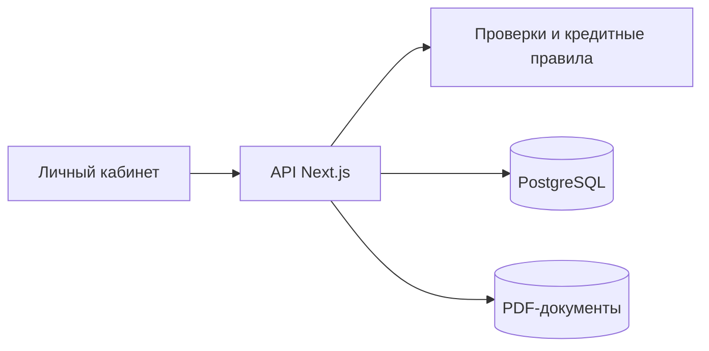

# Дело — умный кредитный кабинет

Хакатонный проект по кейсу Альфа-Банка. Предприниматель заполняет заявку на оборотное финансирование, загружает документы и получает решение с объяснением: полную сумму, меньшую сумму, запрос документов или отказ.

Это независимый прототип. Все компании и условия вымышленные, реальные деньги не выдаются.

## Как попробовать

1. На странице входа выберите демокомпанию.
2. Войдите и прочитайте блок «Ваш демосценарий».
3. Создайте заявку. Для воспроизведения сценариев используйте 2 млн ₽ на 12 месяцев и финансовые показатели по умолчанию.
4. На шаге «Документы» скачайте и загрузите примеры PDF.
5. Отправьте заявку и посмотрите результат. Если получено предложение, его можно принять.

Пароль всех аккаунтов: **`DemoCredit2026!`**.

| Аккаунт              | Что проверить                                                                 |
| -------------------- | ----------------------------------------------------------------------------- |
| `full@demo.local`    | Два PDF → предложение на всю сумму → принятие условий.                        |
| `reduced@demo.local` | Два PDF → предложение на 1,4 млн ₽ вместо 2 млн ₽.                            |
| `clarify@demo.local` | Только выписка → запрос финансового отчёта → дозагрузка → повторная отправка. |
| `reject@demo.local`  | Два PDF → отказ с объяснением: в демоистории есть просрочка 45 дней.          |

Результат зависит от данных заявки. Не загружайте реальные документы в общедоступные демоаккаунты.

Доступен один демонстрационный продукт: **500 тыс.–5 млн ₽, 6–24 месяца, 20% годовых**. Предложение действует 24 часа. Принятие условий завершает демосценарий.

Светлая и тёмная темы переключаются кнопкой в шапке. Смена цветов плавная; выбор сохраняется в браузере. Если в системе отключена анимация, тема меняется сразу.

## Как устроен проект

Next.js, React и TypeScript — интерфейс и API. Prisma и PostgreSQL 17 — данные. PDF хранятся отдельно от публичных файлов. Проверки компании и кредитной истории выполняются локальными симуляторами; решения рассчитываются по заданным правилам.

## Документация

- [Архитектура и границы MVP](ALFA_PROJECT_DOCUMENTATION.md)
- [Техническая спецификация](TECHNICAL_SPECIFICATION.md)

Адрес демонстрационного стенда: https://smart-credit-cabinet.sabirov.tech. 
