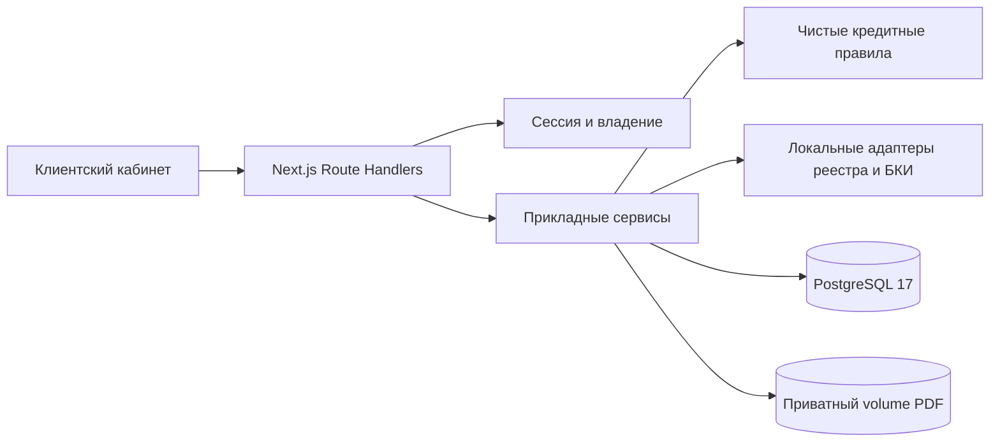

# Дело — умный кредитный кабинет

Независимый хакатонный прототип по кейсу Альфа-Банка. Клиент создаёт заявку на оборотное финансирование, загружает PDF, получает объяснимый результат и принимает демонстрационные условия. Это не официальный сервис банка. Реальные деньги не выдаются.

## Запуск

Требуются Docker Engine и Docker Compose v2 или новее. Из чистого checkout:

```sh
docker compose up --build
```

Открыть http://localhost:3000. Init применяет миграции и добавляет отсутствующие демоаккаунты. PostgreSQL и загруженные файлы хранятся в отдельных volumes. Порт БД наружу не публикуется.

Остановить, сохранив данные: `docker compose down`. Не используйте `down --volumes` для рабочей среды.

## Демонстрация

Общий публичный демопароль: `DemoCredit2026!`.

- `full@demo.local`: заявка 2 млн ₽ на 12 месяцев, два PDF → полное предложение → принять условия.
- `reduced@demo.local`: те же сумма и срок, показатели по умолчанию → предложение 1,4 млн ₽.
- `clarify@demo.local`: загрузить только выписку → запрос документов → добавить финансовый отчёт → отправить повторно.
- `reject@demo.local`: два PDF → отказ по синтетической просрочке 45 дней.

PDF-примеры доступны в форме и в `public/demo-documents`. Не загружайте реальные документы в публичное демо с общедоступными аккаунтами.

Доступен один продукт: 500 тыс.–5 млн ₽, 6–24 месяца, фиксированные 20% годовых. Аннуитет округляется вверх до рубля, предложение действительно 24 часа. Принятие не является подписанием договора.

## Архитектура



Next.js 16 / React 19 / TypeScript 5.9; Tailwind 4; кнопка по композиционному паттерну shadcn с Radix Slot и CVA; React Hook Form; Zod 4; Prisma 7 с PostgreSQL adapter; decimal.js. Точные версии находятся в package-lock.json. Node 22.23.4 согласован в .nvmrc, CI и Docker; npm 11.21.1.

Слой HTTP проверяет Origin, сессию и входные контракты. Сервисы управляют транзакциями, optimistic locking и идемпотентностью. Владение проверяется по userId. Partial unique indexes защищают активные документы и единственное принятое предложение. В UI нет переключателя результата, административного кабинета, LLM или реального скоринга.

## Локальная разработка

```sh
npm ci
cp .env.example .env
# Запустить отдельную локальную PostgreSQL 17 с БД credit.
npm run db:generate
npm run db:migrate
npm run db:seed
npm run dev
```

На Windows `Copy-Item .env.example .env`. Для локальной разработки PostgreSQL должна быть доступна по адресу DATABASE_URL. Compose использует собственный внутренний адрес `db`, независимо от локального .env.

## Конфигурация

- `DATABASE_URL`: приватный адрес PostgreSQL (локальная разработка/тесты).
- `POSTGRES_PASSWORD`: пароль БД Compose; публичный default только для локального демо, на VPS случайный.
- `APP_ORIGIN`: точный origin для мутаций, локально `http://localhost:3000`.
- `COOKIE_SECURE`: `true` для HTTPS; локально `false`.
- `DEMO_MODE`: `true` включает seed и демонстрационные показатели.
- `UPLOAD_DIR`: приватный каталог файлов; локально `./work/uploads`, Docker `/data/uploads`.
- `APP_PORT` и `BIND_ADDRESS`: привязка приложения Compose, default `3000` и `127.0.0.1`.
- `BASE_URL`: адрес стенда для E2E и persistence probe.
- `TEST_DATABASE_URL`: отдельная тестовая БД с суффиксом `_test`; integration требует равенство DATABASE_URL.
- `IMAGE_BASE`, `IMAGE_TAG`: образы GHCR для развёртывания.
- `NEXT_TELEMETRY_DISABLED=1`: отключение telemetry Next.js.

## API и проверки

Swagger UI: `/api-docs`. OpenAPI: `/api/v1/openapi`. Коллекция Postman и environment находятся в `docs/`. Все 21 операции документированы. Для мутаций обязателен Origin, для submit/accept — UUID Idempotency-Key. После сетевого сбоя повторяют тот же ключ и тело.

```sh
npm run check
npm run build
# Предварительно создать credit_test, применить миграции с её DATABASE_URL:
npm run test:integration
npx playwright install chromium
npm run test:e2e
```

Integration действительно использует PostgreSQL. Отсутствие тестовой БД является ошибкой; fallback на mock нет. Unit thresholds: 90% statements/lines/functions и 80% branches для кредитного ядра.

Проверка сохранения данных: `node scripts/persistence-probe.mjs before`, затем restart app, `node scripts/wait-for-ready.mjs`, `node scripts/persistence-probe.mjs after`. Probe хранит тестовую сессию в игнорируемом `work/`.

## CI/CD и эксплуатация

Один `.github/workflows/ci.yml`: quality + docker-e2e → GHCR app/init → deploy → Telegram. PR проходят без пользовательских секретов. Production-деплой разрешён только с main при `DEPLOY_ENABLED=true`. Полная настройка: `deploy/GITHUB_SECRETS.md`.

Адрес целевого стенда: https://smart-credit-cabinet.sabirov.tech. Фактический статус проверок и развёртывания фиксируется в `docs/verification.md`, а не предполагается из наличия конфигурации.

## Ограничения

Один экземпляр приложения и локальный файловый volume; горизонтальное масштабирование не заявляется. Лимитер входа находится в памяти одного процесса. PDF проверяются по расширению, MIME и сигнатуре, без антивируса и анализа содержания. После аварии между записью файла и транзакцией возможен orphan; автоматического удаления исторических файлов нет. Лимит одной заявки — 25 МиБ с учётом истории. Локальные адаптеры детерминированы по синтетической компании.

Deploy сохраняет резервную копию БД и умеет вернуть прежний образ. Автоматический rollback схемы не выполняется: изменения БД должны быть обратно совместимыми, восстановление из dump — отдельная операция.

Исходные требования сохранены в ALFA_PROJECT_DOCUMENTATION.md и TECHNICAL_SPECIFICATION.md. Согласованные отклонения описаны в `docs/decisions.md`. Фактические результаты — в `docs/verification.md`.
